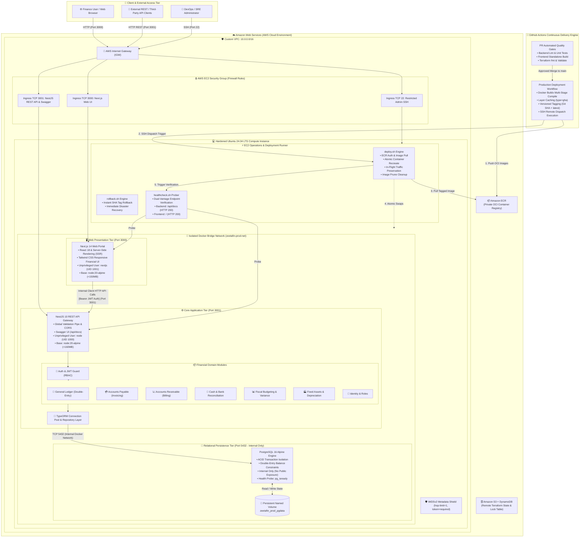
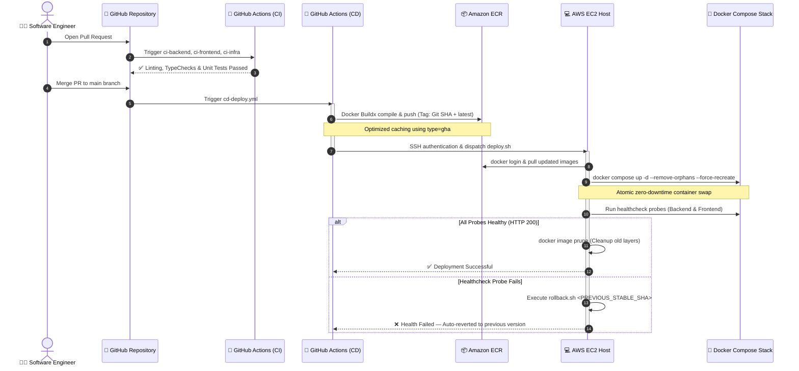

<div align="center">

# 🏛️ ZeetaFin Enterprise Cloud Platform
### Cloud-Native Financial ERP & Automated GitOps CI/CD Delivery Infrastructure

> Production-grade AWS cloud infrastructure, hardened configuration management, multi-stage container orchestration, and zero-downtime CI/CD delivery for an enterprise financial management platform.

<br/>

<!-- Primary Tech Badges -->
<p align="center">
  
  
  
  
  
</p>

<!-- Application Stack Badges -->
<p align="center">
  
  
  
  
  
  
</p>

<!-- Operational Hardening & Quality Badges -->
<p align="center">
  
  
  
  
  
</p>

<p align="center">
  <a href="#-executive-summary">Executive Summary</a> •
  <a href="#-end-to-end-system-architecture">System Architecture</a> •
  <a href="#-system-communication--runtime-flows">Communication Flow</a> •
  <a href="#-enterprise-erp-domain-modules">Core Modules</a> •
  <a href="#-cicd--gitops-automation-engine">CI/CD Engine</a> •
  <a href="#-cloud-infrastructure--security-hardening">Cloud & Security</a> •
  <a href="#-quickstart--developer-ergonomics">Quickstart</a> •
  <a href="#-verified-deployment-evidence">Deployment Evidence</a> •
  <a href="#-technical-writing-series">Technical Articles</a>
</p>

</div>

---

## 🎯 Executive Summary

**ZeetaFin Platform** is an enterprise-grade cloud-native financial management platform (ERP) engineered with bank-grade reliability, strict zero-trust security boundaries, and automated continuous delivery.

Rather than a simple proof-of-concept, this repository implements a **production reference blueprint** demonstrating how modern financial systems decouple web presentation, business logic, state persistence, and cloud infrastructure:

* **Micro-Service Multi-Tier Decoupling**: Standalone **Next.js 14** web portal, modular **NestJS 10** REST API engine, and an isolated **PostgreSQL 16 Alpine** relational database running on internal Docker networks.
* **Declarative Infrastructure as Code (IaC)**: Deterministic AWS provisioning using **Terraform 1.10** with S3 remote state backend and DynamoDB state locking.
* **Idempotent Configuration Automation**: Automated host provisioning, Docker daemon configuration, user permission lockdowns, and firewall bootstrapping with **Ansible**.
* **Zero-Downtime Container Delivery**: Fully automated **GitHub Actions** CI/CD pipeline featuring Docker Buildx layer caching, Amazon ECR immutable image tagging, atomic zero-downtime container swaps, and automated health verification.
* **SRE & Production Hardening**: Instant SHA-based rollback engine (`rollback.sh`), dual-vantage healthcheck probing, least-privilege IAM bot identities, and AWS **IMDSv2** enforcement to eliminate SSRF attack vectors.

---

## 🏛️ End-to-End System Architecture

The ZeetaFin architecture is organized into distinct security zones and network tiers. The diagram below shows the complete topology, including client ingress, network boundaries, containerized microservices, internal communication pathways, and the CI/CD deployment plane.



---

## 🔄 System Communication & Runtime Flows

Understanding how data traverses between the browser, API gateway, domain modules, and database is critical to production operations:

### 1. The Client-to-Backend Request Lifecycle
```text
[ Browser / Client ]
       │
       ▼  1. User navigates or triggers an action in Next.js 14 App Router UI
[ Next.js Frontend ]
       │
       ▼  2. Client-side HTTP request sent with Authorization: Bearer <JWT_TOKEN>
[ NestJS API Gateway (:3001) ]
       │
       ├──► ValidationPipe: Class-validator validates incoming DTO schema
       ├──► JwtAuthGuard: Decodes & verifies token signature and expiration
       ├──► RolesGuard: Enforces RBAC permissions (e.g. ACCOUNTANT, CFO, ADMIN)
       │
       ▼  3. Request routed to target Business Domain Service
[ Core Service (e.g. GeneralLedgerService) ]
       │
       ├──► Validates double-entry accounting integrity (SUM(Debits) == SUM(Credits))
       ├──► Initiates transactional boundary via TypeORM EntityManager
       │
       ▼  4. SQL executed via pooled connection over internal bridge network
[ PostgreSQL 16 (:5432) ]
       │
       ├──► Executes ACID transaction against persistent disk storage
       └──► Returns committed dataset to TypeORM
       │
       ▼  5. Service formats sanitized response DTO
[ Next.js Frontend ] ◄── Returns JSON payload (HTTP 200/201)
       │
       ▼  6. React Server Components & UI hydrate updated financial state
[ End User Interface ]
```

### 2. Microservice Network Isolation
| Communication Channel | Source | Destination | Protocol / Port | Security Boundary |
| :--- | :--- | :--- | :--- | :--- |
| **User Interface** | Public Internet | Next.js Frontend | `HTTP / TCP 3000` | Filtered via AWS EC2 Security Group |
| **REST API Ingress** | Public Internet / UI | NestJS Gateway | `HTTP / TCP 3001` | Filtered via SG; CORS & Helmet protected |
| **Inter-Service API** | Next.js Client | NestJS Backend | `HTTP / TCP 3001` | Bearer JWT Authentication required |
| **Database Connection**| NestJS TypeORM | PostgreSQL | `TCP 5432` | **Isolated Bridge Network** (`zeetafin-prod-net`); **NOT** exposed to host or internet |
| **Admin Operations** | DevOps Admin IP | EC2 Host | `SSH / TCP 22` | Key-pair authentication; IP whitelisted |
| **ECR Image Pull** | EC2 Docker Daemon| AWS ECR | `HTTPS / TCP 443` | IAM Instance Profile & STS Authentication |

---

## 💼 Enterprise ERP Domain Modules

ZeetaFin's application backend is built using a domain-driven modular monolithic architecture in NestJS, ensuring zero cross-domain pollution and high transactional integrity:

<div align="center">

| Module | Core Responsibility | Key Features & Business Rules |
| :--- | :--- | :--- |
| **🔐 Auth & RBAC** | Identity & Access Control | Passport JWT authentication, Bcrypt password hashing, role-based decorators (`Admin`, `Accountant`, `Auditor`). |
| **📒 General Ledger (GL)** | Master Financial Records | Double-entry journal entries, Chart of Accounts (COA), trial balances, debit/credit parity enforcement. |
| **💳 Accounts Payable (AP)** | Vendor Debt & Liabilities | Vendor management, vendor invoice matching, approval workflows, payment execution status tracking. |
| **📈 Accounts Receivable (AR)** | Customer Invoicing & Assets | Customer profile management, sales invoicing, payment status tracking, and receivables aging reports. |
| **🏦 Cash Management** | Bank Liquidity & Treasury | Bank account management, transaction ledger reconciliation, cash position forecasting. |
| **📊 Fiscal Budgeting** | Cost Management & Planning | Annual department budget allocations, monthly budget vs. actual variance analysis. |
| **🏭 Fixed Assets** | Long-term Capital Assets | Capital asset register, straight-line and accelerated depreciation calculation, disposal audits. |
| **👥 User Management** | Organizational Governance | User lifecycle management, departmental assignment, audit logs of critical financial mutations. |

</div>

---

## 🚀 CI/CD & GitOps Automation Engine

The platform operates on a GitOps delivery model using **GitHub Actions**. Every pull request undergoes static analysis and container compilation; merges to `main` initiate zero-downtime rolling deployments on AWS:



### GitHub Actions Workflow Matrix
* [`ci-backend.yml`](.github/workflows/ci-backend.yml): Executes TypeScript compilation, ESLint validation, Jest unit tests, and multi-stage Docker build verification.
* [`ci-frontend.yml`](.github/workflows/ci-frontend.yml): Runs Next.js ESLint, TypeScript strict checking, and standalone compilation tests.
* [`ci-infra.yml`](.github/workflows/ci-infra.yml): Enforces `terraform fmt -check`, `terraform validate`, and infrastructure linting.
* [`cd-deploy.yml`](.github/workflows/cd-deploy.yml): Authenticates with AWS via least-privilege credentials, builds OCI images via Docker Buildx with GitHub Actions cache mounts, pushes immutable SHA tags to Amazon ECR, logs into EC2 over SSH, and triggers `deploy.sh`.

### Production Deployment & Rollback Ergonomics
* **Zero-Downtime Atomic Swaps**: [`deploy/scripts/deploy.sh`](deploy/scripts/deploy.sh) pulls latest images, executes `docker compose up -d --remove-orphans --force-recreate` to ensure port release and container startup without collision, waits for internal health checks, and prunes dangling layers.
* **Instant Rollback Engine**: [`deploy/scripts/rollback.sh`](deploy/scripts/rollback.sh) provides instant, single-command reversion to any previous Git SHA tag if anomalies occur in production:
  ```bash
  # Revert immediately to a known stable commit SHA
  ./deploy/scripts/rollback.sh sha-9f2b84c
  ```
* **Dual-Vantage Healthcheck Engine**: [`deploy/scripts/healthcheck.sh`](deploy/scripts/healthcheck.sh) validates application health from both internal Docker daemon loops and external HTTP curl probes.

---

## 🔒 Cloud Infrastructure & Security Hardening

All cloud infrastructure is declared as code and hardened against enterprise threat models:

```text
zeetafin-platform/infra/
├── terraform/
│   ├── bootstrap/               # S3 Bucket & DynamoDB Table for remote state locking
│   ├── environments/prod/       # Production environment composition root
│   └── modules/
│       ├── networking/          # Custom VPC (10.0.0.0/16), IGW, Subnets, Route Tables
│       ├── security/            # Security Groups, SSH ingress lockdown, IAM bot users
│       ├── compute/             # Hardened EC2 (Ubuntu 24.04 LTS), IMDSv2 enforcement
│       └── registry/            # Amazon ECR repositories with lifecycle retention rules
└── ansible/
    ├── ansible.cfg              # Host key checking, pipelining, SSH optimization
    ├── inventory/prod/          # Dynamic inventory targeting AWS EC2 compute node
    ├── site.yml                 # Master orchestration playbook
    └── roles/                   # Idempotent roles (system_update, docker_install, security)
```

### Defense-in-Depth Highlights
1. **AWS IMDSv2 Hardening**: Compute instances enforce `http_tokens = "required"` and `http_put_response_hop_limit = 1`. This neutralizes Server-Side Request Forgery (SSRF) exploits by preventing attackers from extracting IAM instance role credentials through reverse proxies or application vulnerabilities.
2. **Minimal Non-Root Containers**: Both NestJS and Next.js containers run on minimal `alpine` bases. Compilation utilities (`npm`, `build-essential`) are purged in builder stages. Application processes execute strictly under unprivileged users (`node` UID 1000 and `nextjs` UID 1001).
3. **Database Network Quarantine**: The PostgreSQL database container has **no published ports** on the public interface in production. It is only accessible via the internal Docker bridge network (`zeetafin-prod-net`) by the backend application container.
4. **Least-Privilege IAM & Secret Hygiene**: GitHub Actions utilizes a dedicated IAM deployment bot restricted solely to ECR upload permissions and EC2 deployment dispatch. All production credentials remain protected in encrypted environment templates and secrets vaults.

---

## 📂 Enterprise Monorepo Structure

```text
zeetafin-platform/
├── .github/                           # CI/CD Workflows & Repository Policies
│   ├── workflows/
│   │   ├── ci-backend.yml             # NestJS lint, unit tests, build validation on PR
│   │   ├── ci-frontend.yml            # Next.js lint, type check, standalone build on PR
│   │   ├── ci-infra.yml               # Terraform fmt, validate, tflint, security audit
│   │   └── cd-deploy.yml              # ECR build & push, EC2 SSH deploy trigger
│   └── pull_request_template.md       # Enterprise PR checklist (lint, tests, security)
│
├── apps/                              # Application Microservices
│   ├── backend/                       # NestJS Core ERP API + multi-stage Dockerfile
│   └── frontend/                      # Next.js 14 Web Portal + standalone Dockerfile
│
├── infra/                             # Infrastructure as Code & Config
│   ├── terraform/                     # bootstrap/ (remote state), modules/, environments/prod/
│   └── ansible/                       # Configuration management (ansible.cfg, inventory, roles)
│
├── deploy/                            # Runtime Operations & Ops
│   ├── docker-compose.yml             # Local developer environment
│   ├── docker-compose.prod.yml        # Production runtime stack
│   ├── env/                           # Sanitized .env.example templates
│   └── scripts/                       # deploy.sh, rollback.sh, healthcheck.sh
│
├── docs/                              # Architecture, Runbooks & Articles
│   ├── architecture/                  # System topology diagrams & verified evidence
│   ├── runbooks/                      # disaster-recovery.md, secret-rotation.md
│   └── articles/                      # Complete 12-part technical writing portfolio
│
├── Makefile                           # Developer ergonomics (make dev, make test, make deploy)
├── .gitignore                         # Universal enterprise gitignore
└── README.md                          # Executive recruiter showcase & platform overview
```

---

## ⚡ Quickstart & Developer Ergonomics

The project includes a root `Makefile` designed to give developers and operations engineers an immediate, frictionless workflow:

### Prerequisites
* [Docker Desktop](https://www.docker.com/) 24.0+ and [Docker Compose](https://docs.docker.com/compose/) v2+
* [Node.js](https://nodejs.org/) 20 LTS & `npm`
* [Terraform](https://www.terraform.io/) 1.10+ *(for cloud infrastructure)*
* [AWS CLI](https://aws.amazon.com/cli/) v2 *(configured with admin or deployment credentials)*

### 1. Clone & Start Local Development Stack
```bash
# Clone the repository
git clone https://github.com/Devzane/zeetafin-platform.git
cd zeetafin-platform

# Display the developer command palette
make help

# Spin up the complete stack (Next.js + NestJS + PostgreSQL) with live hot-reload
make dev
```

### 2. Verify Running Services
Once launched, inspect service health and access endpoints:
* **Frontend Web Portal**: [http://localhost:3000](http://localhost:3000)
* **Backend REST API**: [http://localhost:3001](http://localhost:3001)
* **Interactive Swagger OpenAPI Documentation**: [http://localhost:3001/api/docs](http://localhost:3001/api/docs)
* **PostgreSQL Relational Database**: `localhost:5432` (`user: postgres`, `db: zeetafin`)

### 3. Developer Lifecycle Commands
```bash
# Tail live logs across all containers
make dev-logs

# Run full test suites across frontend and backend
make test

# Check code linting and terraform formatting
make lint

# Stop and clean up the development stack
make dev-down
```

---

## 📸 Verified Deployment Evidence

All cloud infrastructure, automation playbooks, and container builds have been verified on AWS:

<div align="center">

| Operational Milestone | Description | Verification Evidence |
| :--- | :--- | :--- |
| **AWS Terraform Provisioning** | Deterministic VPC, subnets, route tables, and compute creation | [View Artifact](docs/architecture/terraform-apply.png) |
| **EC2 Hardware & IMDSv2** | Ubuntu 24.04 LTS instance with strict IMDSv2 token enforcement | [View Artifact](docs/architecture/ec2-instance-summary.png) |
| **SSH Secure Handshake** | Key-pair authentication verified on production host | [View Artifact](docs/architecture/ssh-login.png) |
| **Ansible Playbook Execution** | Automated Docker CE installation & firewall configuration | [View Artifact](docs/architecture/ansible-playbook-run.png) |
| **Zero-Drift Idempotency** | Secondary Ansible run returning 100% `ok` and `changed=0` | [View Artifact](docs/architecture/ansible-idempotency.png) |
| **Docker Engine Health** | Native Docker daemon running containerized multi-tier stack | [View Artifact](docs/architecture/docker-verify.png) |

</div>

---

## 🛠️ SRE Operational Runbooks

Standard Operating Procedures (SOPs) engineered for enterprise production reliability:

* 📖 [**Disaster Recovery Runbook**](docs/runbooks/disaster-recovery.md): Complete disaster recovery protocol for full-region failovers, Terraform re-provisioning, Ansible host re-configuration, and PostgreSQL state restoration from S3 snapshots.
* 🔐 [**Zero-Downtime Secret Rotation Runbook**](docs/runbooks/secret-rotation.md): Operational guide for rotating IAM credentials, database master passwords, and application JWT signing keys without service interruption.

---

## 📚 Technical Writing Series (12-Part DevOps Masterclass)

Every architectural pattern, security gate, and operational script in this repository is thoroughly documented in an engineering deep-dive series located in [`docs/articles/`](docs/articles/):

| Part | Title | Focus Area |
| :---: | :--- | :--- |
| **01** | [AWS VPC Infrastructure with Terraform](docs/articles/01-aws-vpc-infrastructure-terraform.md) | Custom VPC, CIDR partitioning, IGW, route tables |
| **02** | [EC2 IAM & IMDSv2 Hardening](docs/articles/02-ec2-iam-imdsv2-hardening.md) | Security Groups, IAM instance profiles, anti-SSRF defense |
| **03** | [Ansible Automation for Docker](docs/articles/03-ansible-automation-docker.md) | Configuration management, package locks, Docker engine |
| **04** | [Idempotency Testing & Drift Detection](docs/articles/04-idempotency-testing-troubleshooting.md) | Idempotency validation, zero-drift host state |
| **05** | [Enterprise App Architecture & Container Strategy](docs/articles/05-enterprise-app-architecture-docker-overview.md) | Multi-tier decoupling, runtime isolation, non-root users |
| **06** | [NestJS Backend Multi-Stage Docker Build](docs/articles/06-nestjs-backend-multi-stage-docker-build.md) | Alpine optimization, dependency pruning, build caching |
| **07** | [Next.js Standalone Containerization](docs/articles/07-nextjs-frontend-standalone-containerization.md) | Next.js standalone output, minimal production image size |
| **08** | [Docker Compose Orchestration & ECR Delivery](docs/articles/08-docker-compose-orchestration-and-ecr-push.md) | Service dependency chaining, native healthcheck loops |
| **09** | [AWS IAM & ECR Security](docs/articles/09-aws-iam-ecr-github-secrets-security.md) | Least-privilege IAM deployment bots, secrets hygiene |
| **10** | [GitHub Actions CI/CD Pipeline Architecture](docs/articles/10-github-actions-ci-cd-workflow-architecture.md) | Workflow triggers, Buildx layer caching, concurrency groups |
| **11** | [EC2 Remote Deployment Engine Automation](docs/articles/11-ec2-remote-deployment-engine-automation.md) | Atomic container recreation, dual-vantage healthcheck |
| **12** | [End-to-End Verification & SRE Observability](docs/articles/12-end-to-end-verification-observability-troubleshooting.md) | Smoke testing, rollback mechanics, failure recovery |

---

## 👨‍💻 Author & Engineering Credits

**Architected & Implemented by [Devzane](https://github.com/Devzane)** as part of the Vectra Automation enterprise initiative.

Designed as an end-to-end portfolio reference demonstrating modern DevOps engineering, cloud-native architecture, infrastructure as code, and production reliability.

For inquiries, code walkthroughs, or opportunities:
* **GitHub**: [@Devzane](https://github.com/Devzane)
* **Repository**: [https://github.com/Devzane/zeetafin-platform](https://github.com/Devzane/zeetafin-platform)
* **License**: MIT
