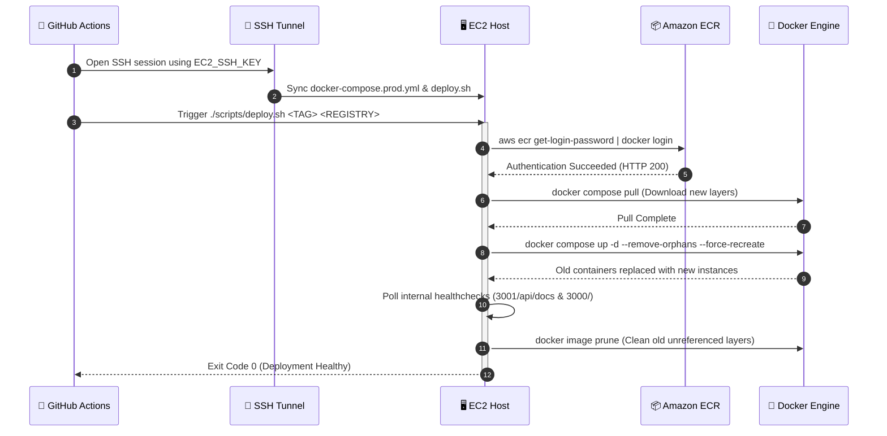

# Production Deployment Automation: Remote EC2 Orchestration and Zero-Downtime Rollouts

Building and publishing container images to a registry is only half of continuous deployment. The critical phase occurs when those images arrive on target cloud virtual machines:
* How do you swap running containers without port collisions?
* How do you prevent old containers from shutting down if the new image fails to pull?
* How do you prevent the host's disk from filling up after dozens of daily builds?

In Part 11 of our DevOps series, we build and analyze the remote deployment engine for **ZeetaFin ERP**: an idempotent, automated deployment script (`deploy.sh`) executed on AWS EC2 via GitHub Actions.

---

## 1. Remote Deployment Sequence

Here is how the automated rollout executes on the production EC2 host:



---

## 2. Production Compose Specification (`docker-compose.prod.yml`)

Unlike local development where images are built from local directories (`build: ./backend`), production compose manifests reference remote registry URIs and dynamic tags:

```yaml
services:
  db:
    image: postgres:16-alpine
    container_name: zeetafin-db-prod
    restart: unless-stopped
    environment:
      POSTGRES_USER: ${POSTGRES_USER:-postgres}
      POSTGRES_PASSWORD: ${POSTGRES_PASSWORD:-zeetafin_secret}
      POSTGRES_DB: ${POSTGRES_DB:-zeetafin}
    ports:
      - "5432:5432"
    volumes:
      - zeetafin_prod_pgdata:/var/lib/postgresql/data
    healthcheck:
      test: ["CMD-SHELL", "pg_isready -U ${POSTGRES_USER:-postgres} -d ${POSTGRES_DB:-zeetafin}"]
      interval: 10s
      timeout: 5s
      retries: 5
      start_period: 10s
    networks:
      - zeetafin-prod-net

  backend:
    image: ${ECR_REGISTRY}/zeetafin-backend:${IMAGE_TAG:-latest}
    container_name: zeetafin-backend-prod
    restart: unless-stopped
    environment:
      PORT: 3001
      DB_HOST: db
      DB_PORT: 5432
      DB_USERNAME: ${POSTGRES_USER:-postgres}
      DB_PASSWORD: ${POSTGRES_PASSWORD:-zeetafin_secret}
      DB_NAME: ${POSTGRES_DB:-zeetafin}
      JWT_SECRET: ${JWT_SECRET:-super_secret_jwt_key_zeetafin_devops_assignment_2026}
      NODE_ENV: production
      DB_SYNC: "true"
      DB_LOGGING: "false"
    ports:
      - "3001:3001"
    depends_on:
      db:
        condition: service_healthy
    healthcheck:
      test: ["CMD-SHELL", "wget --no-verbose --tries=1 --spider http://127.0.0.1:3001/api/docs || exit 1"]
      interval: 15s
      timeout: 5s
      retries: 5
      start_period: 20s
    networks:
      - zeetafin-prod-net

  frontend:
    image: ${ECR_REGISTRY}/zeetafin-frontend:${IMAGE_TAG:-latest}
    container_name: zeetafin-frontend-prod
    restart: unless-stopped
    environment:
      PORT: 3000
      NEXT_PUBLIC_API_URL: ${NEXT_PUBLIC_API_URL:-http://localhost:3001/api}
    ports:
      - "3000:3000"
    depends_on:
      backend:
        condition: service_healthy
    healthcheck:
      test: ["CMD-SHELL", "wget --no-verbose --tries=1 --spider http://127.0.0.1:3000/ || exit 1"]
      interval: 15s
      timeout: 5s
      retries: 5
      start_period: 15s
    networks:
      - zeetafin-prod-net

volumes:
  zeetafin_prod_pgdata:
    name: zeetafin_prod_pgdata
    driver: local

networks:
  zeetafin-prod-net:
    name: zeetafin-prod-net
```

### Key Architectural Safeguards

1. **Persistent Data Volume Isolation:** The named volume `zeetafin_prod_pgdata` is declared as external to container lifecycles. When PostgreSQL is recreated, data files on the host block storage remain completely untouched.
2. **Cascading Healthcheck Dependencies:** Frontend depends on Backend being `service_healthy`; Backend depends on Database being `service_healthy`. Containers only start when their dependencies are actively responding.

---

## 3. The Deployment Engine Script (`scripts/deploy.sh`)

Here are the key operational sections of our deployment engine:

### Step 1: Pre-Pulling Images Before Shutdown

Many broken deployment scripts run `docker stop` or `docker compose down` before pulling images. If network bandwidth is constrained or the image pull fails, your production service is down.

Our engine pulls new images **while the existing containers are still serving traffic**:

```bash
# Pull new layers without stopping existing containers
log_info "Pulling updated Docker container images (tag: ${IMAGE_TAG})..."
docker compose -f "${COMPOSE_FILE}" pull
```

### Step 2: Atomic Replacement with `--force-recreate`

Once new image layers exist locally on the host, we recreate the containers:

```bash
log_info "Deploying updated container instances with minimal downtime..."
docker compose -f "${COMPOSE_FILE}" up -d --remove-orphans --force-recreate
```

* `--remove-orphans`: Cleans up any deprecated service containers that may have existed in older compose files.
* `--force-recreate`: Forces Docker to stop the old container and immediately spawn the new container with the newly pulled image layer, avoiding manual stop/start cycles.

### Step 3: Polling Internal Health Probes

Rather than blindly trusting that the container process is alive, `deploy.sh` polls internal endpoints before reporting success to GitHub Actions:

```bash
check_endpoint() {
  local url="$1"
  local name="$2"
  local attempts=0
  local max_attempts=20
  local sleep_interval=3

  while [ $attempts -lt $max_attempts ]; do
    attempts=$((attempts + 1))
    if curl -s -f -o /dev/null "${url}"; then
      log_success "${name} is healthy at ${url} (attempt ${attempts}/${max_attempts})"
      return 0
    fi
    log_warn "${name} not ready yet. Retrying in ${sleep_interval}s..."
    sleep $sleep_interval
  done

  log_error "Healthcheck failed for ${name} at ${url}."
  return 1
}

# Validate Backend Swagger Docs & Frontend UI
check_endpoint "http://127.0.0.1:3001/api/docs" "ZeetaFin Backend"
check_endpoint "http://127.0.0.1:3000/" "ZeetaFin Frontend"
```

If either endpoint fails to respond with HTTP 200 within 60 seconds, the script exits with code `1`, immediately causing GitHub Actions to mark the deployment as failed and alerting the team.

### Step 4: Disk Space Hygiene & Garbage Collection

Every Docker build creates new image layers. Over weeks of daily deployments, older dangling layers will consume 100% of the EC2 root EBS volume (`no space left on device`).

`deploy.sh` automatically performs garbage collection after successful deployments:

```bash
log_info "Cleaning up obsolete dangling images..."
docker image prune -f --filter "until=24h" || true
```

The filter `--filter "until=24h"` protects recent images needed for immediate rollback, while pruning abandoned layers older than 24 hours.

---

## 4. Execution Workflow from GitHub Actions

In `.github/workflows/deploy.yml`, Job 2 triggers `deploy.sh` remotely over SSH:

```yaml
- name: Execute Deployment & Container Replacement on EC2
  run: |
    ssh -i ~/.ssh/deploy_key -o StrictHostKeyChecking=no "${EC2_USER}@${EC2_HOST}" << 'EOF'
      set -euo pipefail
      cd /home/ubuntu/zeetafin-app
      chmod +x scripts/deploy.sh scripts/healthcheck.sh

      export AWS_ACCESS_KEY_ID="${{ secrets.AWS_ACCESS_KEY_ID }}"
      export AWS_SECRET_ACCESS_KEY="${{ secrets.AWS_SECRET_ACCESS_KEY }}"
      export AWS_DEFAULT_REGION="${{ secrets.AWS_REGION || 'us-east-1' }}"
      export ECR_REGISTRY="${{ needs.build-and-push.outputs.ecr_registry }}"
      export IMAGE_TAG="${{ needs.build-and-push.outputs.image_tag }}"
      export NEXT_PUBLIC_API_URL="http://${{ secrets.EC2_HOST }}:3001/api"

      ./scripts/deploy.sh "${IMAGE_TAG}" "${ECR_REGISTRY}" "${AWS_DEFAULT_REGION}"
    EOF
```

---

## 5. Production Takeaways

1. **Pull Before Recreating:** Never stop old containers before confirming that new images are downloaded and unpacked.
2. **Healthcheck-Driven Deployments:** A deployment script must not exit `0` until endpoints return verified HTTP `200 OK` statuses.
3. **Automate Garbage Collection:** Unmanaged Docker hosts inevitably suffer disk outages. Include `docker image prune` in every deployment run.

---

## Next Steps

Now that our deployment engine is operational, we examine end-to-end pipeline verification, external smoke testing, failure triage, and rollback strategies.

👉 **Next in Series:** [Part 12: End-to-End Pipeline Verification, Health Probes, and Failure Recovery](./04-end-to-end-verification-observability-troubleshooting.md)
